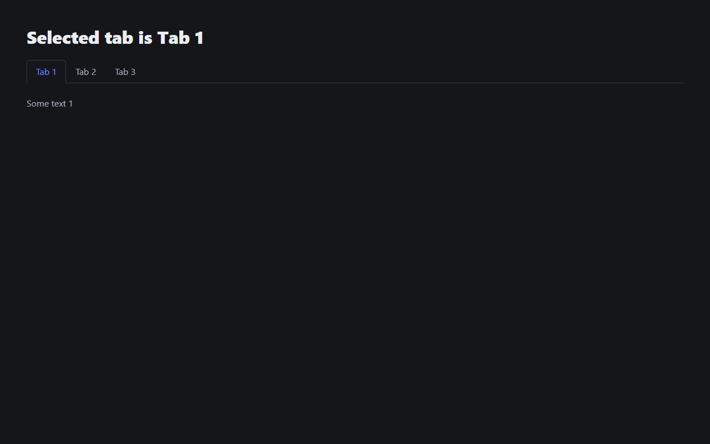

# Tabs component – React

Reusable, stateless `Tabs` component: the user switches between tabs and sees the content of the selected one.

**[▶ Live demo](https://natakovbasniuk.github.io/react_tabs-js/)**



## What I implemented
- Stateless `Tabs` component driven only by props: `tabs`, `activeTabId`, `onTabSelected`
- Active tab stored in the `App` state and updated through the callback
- Falls back to the first tab if `activeTabId` is unknown; the callback fires only for a non-active tab
- Title of the active tab in the heading: "Selected tab is Tab 1"

## Tech stack
React, JavaScript, Vite

## Run locally
```bash
npm install
npm start
```

---
Course project at [Mate Academy](https://mate.academy): the task and layout were provided by the course, the React logic is my implementation.
